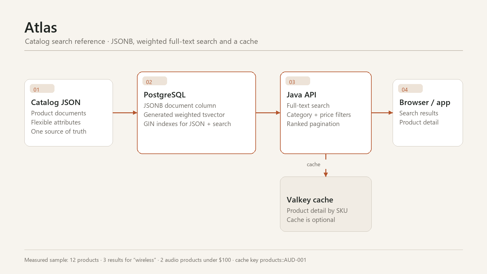

# Atlas

**Label:** Reference build

**One line:** A catalog API that uses PostgreSQL JSONB and weighted full-text
search, with a Valkey cache, instead of adding a separate document database and
search cluster.

**Stack:** Java 17, Spring Boot, PostgreSQL JSONB, generated `tsvector`, GIN,
websearch queries, Valkey, Docker Compose, Testcontainers

**Assets:**

- `screenshots/atlas-architecture.png`
- `screenshots/atlas-swagger.png`

## The problem

A product catalog has flexible attributes and needs search, category filters,
price filters, and a product detail page. The default advice is to add MongoDB
and Elasticsearch. That creates two more services, two more failure modes, and a
consistency problem before the catalog has proven it needs them.

Atlas asks a narrower question: how far can one PostgreSQL instance go?

## What was built

- Product documents live in a `JSONB` column.
- A generated weighted `tsvector` indexes name, description, brand, and tags.
- GIN indexes cover JSON containment and full-text search.
- Search uses `websearch_to_tsquery` and `ts_rank`.
- Category and maximum-price filters run alongside the text query.
- Product detail is cached in Valkey by SKU.
- A read-only Spring Boot API exposes products, search, and categories.
- Docker Compose and Testcontainers run against real PostgreSQL and Valkey.

## Measured sample run

| Result | Count |
|---|---:|
| Products | 12 |
| Results for “wireless” | 3 |
| Audio products under $100 | 2 |
| Categories | 4 |

The cache produces a real key such as `products::AUD-001`.

Tests: **3 integration tests passing**. Audit: **A 100/100**. Security scan:
clean.

## Architecture

## Key decisions

- **One database for transactional and search data.** Lower operational load,
  one backup boundary, one consistency story.
- **Generated search column.** Ranking is part of the schema, not application
  code.
- **Cache optional.** Removing Valkey leaves a working API; the cache is a
  performance layer, not a source of truth.
- **Read-only.** No write endpoint means no unauthenticated catalog mutation.
- **Search engine escape hatch.** A dedicated engine is the right next step when
  relevance tuning, language analysis, and independent scaling outweigh the
  operational cost.

The tradeoff is explicit: PostgreSQL full-text search is not Elasticsearch. If
the catalog needs per-language analyzers, sophisticated relevance experiments,
or independent search scaling, add a search service and an outbox. Do not add it
on day one just because the stack list looks better.

## How this runs for a client

- Azure: Container Apps + PostgreSQL Flexible Server + Azure Managed Redis;
  add Azure AI Search only when the relevance requirements justify it.
- AWS: ECS Fargate + RDS PostgreSQL + ElastiCache/Valkey; OpenSearch when the
  search workload outgrows the database.
- Keep the cache private, set a TTL, and invalidate on catalog change.
- Use a queue/outbox if a second search index is added; never dual-write from
  the request thread.

## What a client engagement looks like

1. Model the product document and the queries that matter.
2. Build the search and filter API against real data.
3. Measure the query plan and result quality.
4. Add caching only after the query path is understood.
5. Decide whether a dedicated search engine is justified, with evidence.

## Limits

- No write/admin API or authentication.
- No search relevance evaluation set.
- No synonym, stemming, or multilingual tuning.
- No multi-node or failover configuration.
- The cache has no custom TTL or invalidation policy yet.
